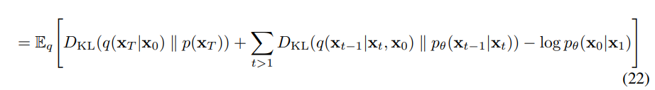
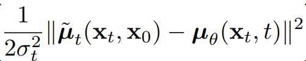
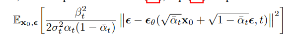

# DDPM
DDPM 最重要的贡献就是简化了训练目标，2015 年的原论文采用最大化对数似然估计（MLE），并借此推导出一个简化的 KL 散度作为训练目标，然而 DDPM 发现 MLE 最优不能代表图像生成的最优解，微小的偏差人眼难以看出，但会干扰模型收敛。DDPM 使用均方误差（MSE）作为训练目标，直接优化模型的输出与真实图像之间的差异，从而提高了生成图像的质量和训练的稳定性。

## 加噪过程
从原始图像 x0 开始，DDPM 通过逐步添加高斯噪声将其转换为纯噪声图像 xt：
x1 = x0 + beta * I
x2 = x1 + beta * I
...
累加得: xt = x0 + beta * t * I
也可以写成: q(xt|x0) = N(x0, beta * t * I)，其中 I 是单位矩阵，epsilon 是从标准高斯分布中采样的噪声。这个过程可以看作是一个马尔可夫链，每一步都将图像向高斯噪声的方向推进。

然而，这样的过程有一个问题，即随着 t 的增加，噪声的方差也会增加，导致生成的图像质量下降。此外，我们的最终目标是随着t趋近于无穷，收敛到标准高斯分布。这样可以确保生成的图像具有良好的统计特性。具体来说，DDPM 采用了一个线性调度的 beta 参数，使得在训练过程中，随着 t 的增加，beta 的值逐渐增大，并且在xt-1前引入一个缩放系数，把平均值收敛到 0。

公式可以写成: q(xt|xt-1) = N(sqrt(1 - beta) * xt-1, beta * I)，其中 beta 是一个小的正数，通常在 0.0001 到 0.02 之间。通过这种方式，DDPM 可以在训练过程中逐步引入噪声，同时保持生成图像的质量。这是一个普通的递推式，另 alpha = 1 - beta，求解递推式通项，得到如下结果：
q(xt|x0) = N(sqrt(alpha_bar) * x0, (1 - alpha_bar) * I)，其中 alpha_bar = ∏(1 - beta_i)，i 从 1 到 t。
经过无穷多的 t 步后，一张标准图片就会被逐步转化为 N(0, I) 的高斯噪声分布。由于通项公式的存在，我们可以直接从 x0 采样到 xt，而不需要经过每一步的迭代，这大大提高了训练和采样的效率。

## 反向过程
在加噪过程的基础上，DDPM 还定义了一个反向过程，用于从噪声图像 xt 逐步恢复到原始图像 x0。这个反向过程也是一个马尔可夫链，每一步都试图去除噪声，恢复图像的细节。
反向过程的公式可以写成: p_theta(xt-1|xt)，theta 表示这是一个可训练模型权重
优化目标：-log p_theta(x0)，对数似然估计是常用的路径优化函数
定义一些变量：
q(x1,..., xT|x0) = ∏(q(xt|xt-1))，t 从 1 到 T，代表正向加噪路径的联合概率密度函数，需要引入一个初始图像 x0
p_theta(x0,..., xT) = p_theta(xT)∏(p_theta(xt-1|xt))，t 从 1 到 T，代表单次反向生成过程的联合分布,逆向过程没有先验条件，可以从纯高斯分布开始。
我们想要得到对于所有去噪过程的最优解，就要最大化对数似然估计：- log p_theta(x0)
其中 p_theta(x0) = ∫ p_theta(x0,..., xT) dx1...dxT，只要能算出这个积分，就能求到 x0 的边缘概率密度，具体表现在对每一条路径上的每个点进行加总，而这几乎是不可能做到的，因此这个积分无法直接算出。
一个好方法是在上下同乘一个 q(x1,..., xT|x0) 的分布，得到如下公式：
-log p_theta(x0) = -log ∫ p_theta(x0,..., xT) dx1...dxT
= -log ∫ p_theta(x0,..., xT) * (q(x1,..., xT|x0) / q(x1,..., xT|x0)) dx1...dxT
= -log E_{q(x1,..., xT|x0)}[p_theta(x0,..., xT) / q(x1,..., xT|x0)]
这里的 q 代表从 x0 出发不同路径的概率分布，对每一项求积的结果就是对所有路径的期望值，我们希望最大化这个期望值，然而直接求解这个期望值也是不可能的，因此我们可以使用詹森不等式外提期望得到ELBO: 
-log p_theta(x0) <= E_{q(x1,..., xT|x0)}[-log(p_theta(x0,..., xT) / q(x1,..., xT|x0))] = L_ELBO
到这里其实已经可以开始训练了，但是我们还可以进一步简化这个公式，得到一个更容易优化的目标函数。通过对 L_ELBO 进行分解，我们可以将其表示为一系列的 KL 散度和重构误差的和，从而使得训练过程更加稳定和高效。（最重要的一点是降低了对随机蒙特卡罗过程的依赖，从而提高了训练的稳定性和收敛速度。）
经过一系列复杂的推导可以得到这个式子：

其中第一项不参与训练，第三项又非常微小，因此优化目标集中在第二项
并且值得注意的是，保留下来的第二项具有直观的数学意义，它衡量了真实去噪结果与模拟去噪结果之间的差异。
经计算，真实的后验分布q(xt−1|xt, x0)是高斯分布，为了方便起见，我们把神经网络的输出分布也设定为高斯分布，记为pθ(xt−1|xt) = N(μθ(xt, t), Σθ(xt, t))，其中μθ和Σθ分别表示神经网络的均值和协方差矩阵。通过这种方式，我们可以将优化目标转化为最小化两个高斯分布之间的 KL 散度，从而实现对神经网络参数的有效训练。为了方便起见，我们直接把方差设为定值：Σθ(xt, t) = σt^2 * I，这样我们只需要优化均值μθ(xt, t)即可。最终的优化目标可以表示为：

根据加噪过程中的通项公式，对均值表达式进行化简，消去xt项，得到最终损失函数：

实际训练过程通常会省略系数，只保留均方误差的部分。