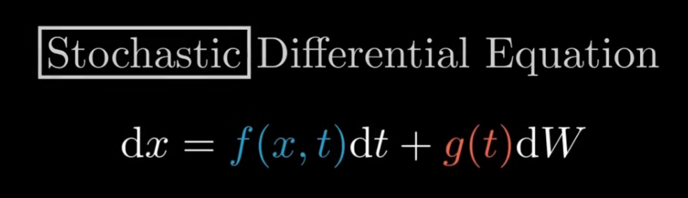

这个公式是我们推导的核心，SDE 这篇论文建立了 DDPM 公式和 Score-Based 模型之间的联系。以 DDPM 核心递推式为起点，构造一个 一疼方程 (如上图)

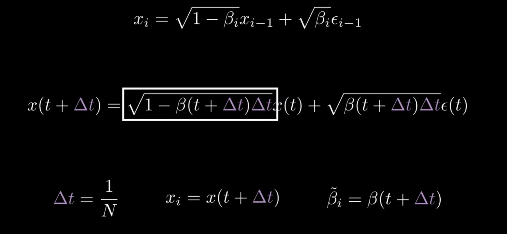

把原本离散的递推式做连续化处理，记总步数为 N 是一种常见思路。级数求和对定积分的转换也用了类似的思想
带入 delta_t，进行泰勒展开，可以得到如下式子：

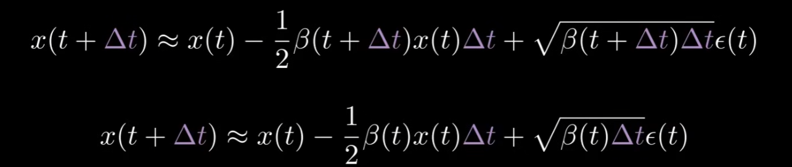

让 delta_t 逼近于 0，得到微分方程：

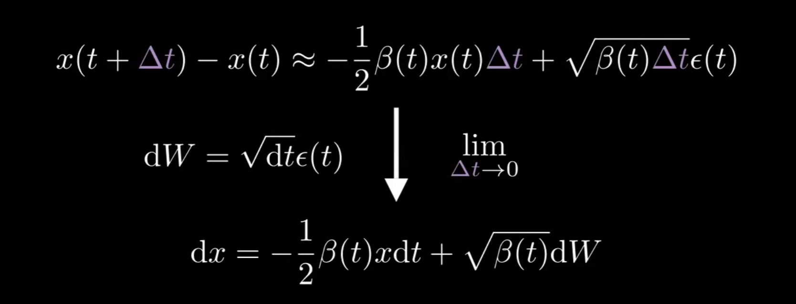

这个式子和伊藤方程形式完全一致，分为 drift 和 diffusion 两部分，drift 是漂移项，diffusion 是扩散项。
由于推导过程均为等价变换，因此我们可以把这个伊藤方程看做 DDPM 的连续形式。

伊藤方程的时间反演形式在 1982 年由 Anderson 提出，形式如下：

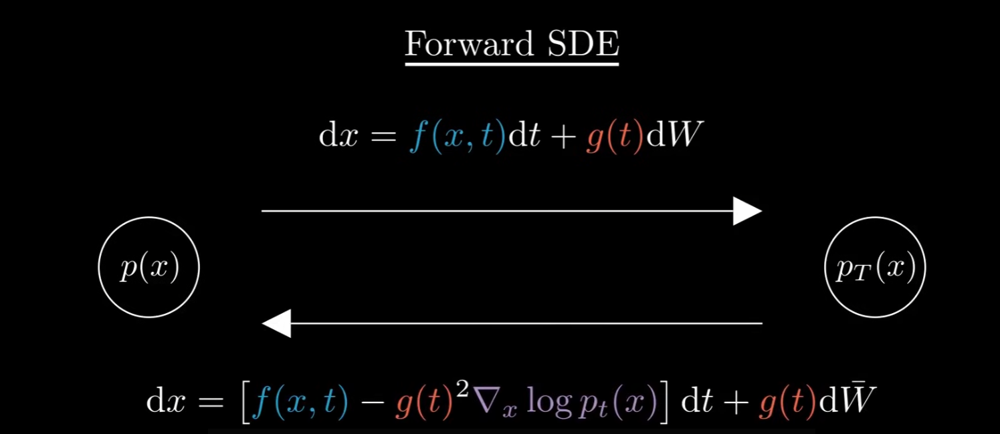

代入我们从 DDPM 推导的 f 和 g，得到：

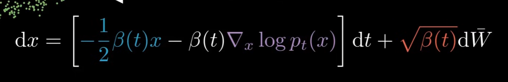

这个梯度值描述了一个向量场，向量会指向高维空间中概率密度较大的区域(以一维正态分布为例，y 轴以左会指向右边，y 轴以右会指向左边)，因此我们可以把这个向量场看做一个“概率密度的梯度场”，也就是 Score Function。直觉上看，t 越大，噪声越大，概率密度越平坦，越趋近于标准正态分布。

接下来的问题是，模型怎么学习这个参数。通常，我们会使用 U-Net 结构的神经网络，输入一张带噪图和它对应的加噪步骤 t，输出一个向量场，表示当前图片的 Score Function。训练时，我们会使用 MSE 损失函数，让模型预测的 Score Function 尽可能接近真实的 Score Function，就像这样：

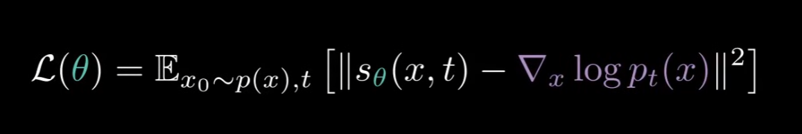

不过问题是，真实的 Score Function 标签是未知的，我们无法直接计算它。为了解决这个问题，论文提出了一个巧妙的技巧：通过重参数化技巧，将 Score Function 的学习转化为对噪声的预测。

代入 DDPM 公式的条件分布，对高斯函数取对数后求导，可以化简得到一个很简单的式子：

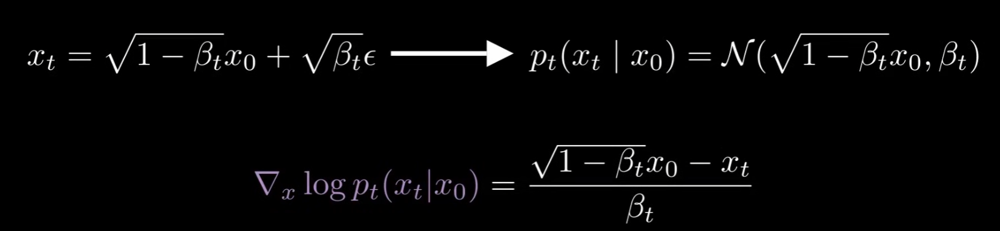

把xt代换，进一步化简，我们会发现这个梯度值只依赖于噪声项 ε，而与原始图片 x0 无关。也就是说，我们可以通过让模型预测噪声 ε 来间接学习 Score Function。DDPM 的思路就是通过这个重参数化技巧，把 Score Function 的学习问题转化为对噪声的预测问题，从而实现对生成模型的训练，在这里又用了相同的技巧

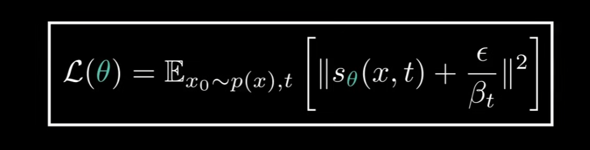
这个就好算多了，因为噪声项 ε 是从标准正态分布中采样的，因此我们可以直接计算它的 MSE 损失函数：

模型需要生成噪声，表示如下：
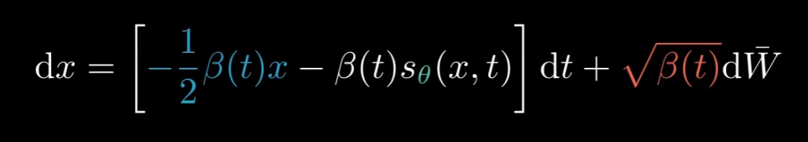

为了生成数据，我们需要把这个方程离散化，这里用 Euler-Maruyama 方法，得到如下公式：
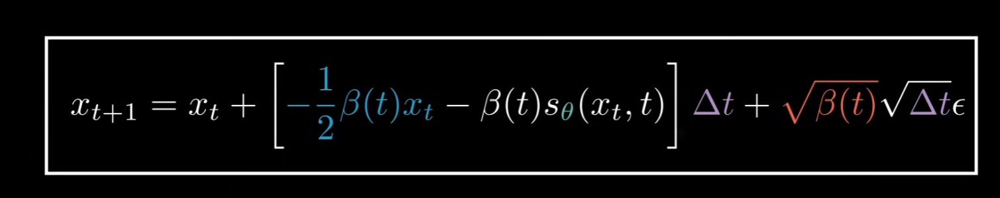

其中s_theta由模型生成